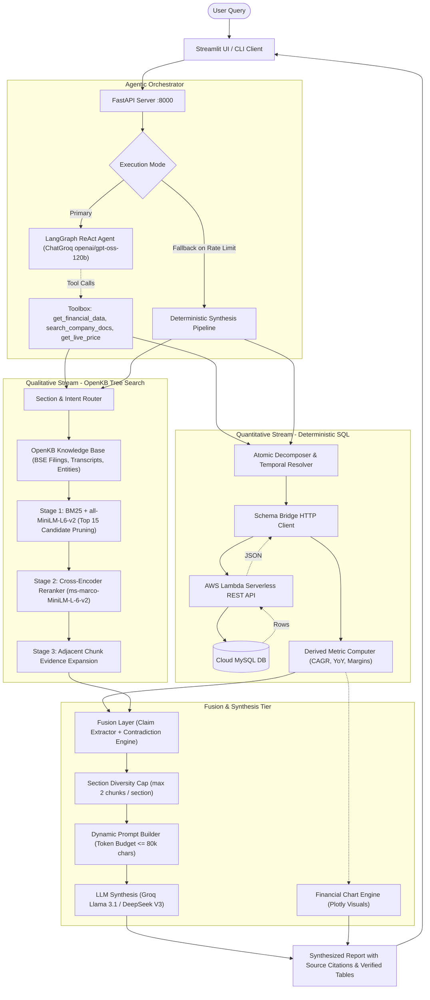

# Financial RAG Platform 📈

[](https://www.python.org/downloads/)
[](https://fastapi.tiangolo.com/)
[](https://github.com/langchain-ai/langgraph)
[](https://modelcontextprotocol.io/)
[]()

An advanced, hybrid Retrieval-Augmented Generation (RAG) platform tailored for institutional equity research and financial intelligence. The system synchronizes verified quantitative figures from audited financial statements (via serverless SQL APIs) with qualitative context from statutory filings and earnings call transcripts (via an OpenKB hierarchical knowledge store).

---

## 🏛️ Knowledge Base on Top: The OpenKB Architecture

At the core of the platform is **OpenKB** — a domain-specialized, structured financial knowledge base that moves beyond flat text dumps. Indexed under `backend/data/openkb_wiki/`, it houses:

```
backend/data/openkb_wiki/wiki/
├── summaries/   # Granular multi-part annual reports (e.g. Apollo Micro Systems FY25-FY26 Parts 1–11) & concalls
├── entities/    # 80+ Pre-compiled corporate profiles (DRDO, Indian Navy, BEL, BDL, subsidiaries, key executives)
└── concepts/    # Accounting & operational standards (CWIP, Ind AS 103, Key Audit Matters, Counter-Drone, Torpedoes)
```

- **Structural Section Tagging:** Every text block is indexed with explicit metadata (`symbol`, `year`, `doc_type`, `section_type`, `heading`, `page_start`), enabling high-precision targeted retrieval.
- **Relational Knowledge Graph:** Connects defense programs, suppliers, customer agencies, subsidiaries, and management commentary directly to statutory financial notes.
- **Adjacent Evidence Expansion:** When a key disclosure is retrieved, the engine automatically expands the window to adjacent predecessor and successor chunks, ensuring cross-page financial tables and footnotes remain intact.

---

## ⚡ Why Vectorless / Structurally Selective over Pure Vector RAG?

Standard Vector RAG embeds documents into arbitrary text chunks and retrieves them using vector similarity (ANN). In institutional financial analysis, **traditional vector databases consistently fail**:

| Vector RAG Limitation | Structurally Selective RAG (This System) |
| :--- | :--- |
| **Number & Table Corruption:** Arbitrary chunking slices multi-column financial statements across rows, distorting numbers and severing footnote references. | **Deterministic Quantitative Path:** Queries for metrics (EBITDA, ROCE, Capex) bypass vectors entirely and extract verified rows from SQL tables via the **Schema Bridge**. |
| **Loss of Fiscal Period Anchors:** Semantic vectors cannot differentiate between FY24 actuals and FY25 projections when token phrasing is near-identical. | **Temporal Resolver & Schema Mapping:** Exact Indian Fiscal Year logic (`April 1` – `March 31`) maps queries directly to structured date keys. |
| **Context Starvation by Redundancy:** A search for "revenue" retrieves multiple identical standalone and consolidated statement variants, crowding out critical risk disclosures. | **Section Diversity Capping:** Enforces a hard limit (`MAX_CHUNKS_PER_SECTION = 2`), guaranteeing multi-perspective context (numbers + MD&A + risk factors). |
| **High Compute & Latency Bloat:** Passing 40+ raw vector chunks directly to an LLM inflates Time-To-First-Token (TTFT) and triggers rate limits. | **Aggressive Two-Stage Pruning:** Hybrid BM25/Dense candidate pool is pruned to **15 candidates**, reranked via a PyTorch Cross-Encoder (**62% CPU reduction**), delivering an average query response in **~6.5s**. |
| **Unchecked Hallucinations:** Vector search cannot detect when executive claims in earnings calls contradict audited numbers. | **Fusion Reconciliation Engine:** Extracts numeric claims from concall transcripts and cross-references them against audited SQL actuals (`CONFIRM`, `CONTRADICT`, `FORWARD`). |

---

## 🛠️ Tech Stack

```
Interface & Serving:        FastAPI, Streamlit, Uvicorn, JSON Lines / SSE
Agent & Orchestration:      LangGraph (ReAct Loop), LangChain Core, ChatGroq, DeepSeek V3 / R1 Fallback
Retrieval & Cross-Encoding: SentenceTransformers (all-MiniLM-L6-v2), PyTorch Cross-Encoder (ms-marco-MiniLM-L-6-v2), BM25
Tool Protocol:              Model Context Protocol (FastMCP) with stdio & SSE Transports (Port 8100)
Quantitative Data Backend:  Cloud MySQL, Serverless AWS Lambda REST API, YFinance (Live Market Data)
Storage & Document Repo:    MinIO Object Storage, Hierarchical Markdown OpenKB
Visualization & Analytics:  Plotly Express & Graph Objects, NumPy, Pandas
Codebase Knowledge Graph:   Graphifyy AST Analysis (1,836 nodes, 2,497 edges, 165 communities)
```

---

## 🔄 Dual-Stream RAG Pipeline Architecture



### Pipeline Execution Steps:
1. **Query Pre-processing & Decomposition:** Expands relative temporal phrases (e.g., *"since FY22"*) into explicit ranges and resolves entities to canonical stock tickers (`APOLLO`, `HAL`, `RELIANCE`).
2. **Parallel Retrieval:**
   - **SQL Path:** Concurrently calls AWS Lambda endpoints (`profit-loss`, `balance-sheet`, `cash-flow`) and computes EBITDA, YoY growth, and margin statistics deterministically.
   - **Text Path:** Routes queries to relevant document sections (`financials`, `md&a`, `risk`, `entity`), prunes candidates to 15, applies Cross-Encoder reranking, and expands adjacent chunk windows.
3. **Fusion & Contradiction Detection:** Extracts numeric assertions from concalls, compares them against audited figures, and tags them (`CONFIRM` within $\pm 10\%$, `CONTRADICT` beyond $15\%$, `FORWARD` for future guidance).
4. **Prompt Assembly & High-Speed Synthesis:** Formats verified tables and diverse quotes into a prompt capped under 80,000 characters and streams response from Groq / DeepSeek.

---

## 🔌 Model Context Protocol (MCP) Integration

The platform includes a dedicated **FastMCP Server** (`backend/mcp_server.py`) that exposes the entire analytical pipeline as standardized MCP tools. Any MCP-compatible assistant (Cursor IDE, Claude Desktop, Antigravity) can query financial metrics, market data, and regulatory documents natively.

### Available MCP Tools (18+ Tools):
- **Financial Statements:** `get_profit_loss`, `get_profit_loss_items`, `get_balance_sheet`, `get_balance_sheet_items`, `get_cash_flow`, `get_cash_flow_items`, `get_quarterly_results`, `get_quarterly_items`.
- **Market & Technicals:** `get_price` (daily OHLCV), `get_technicals` (RSI, MACD, Bollinger Bands), `get_live_market_data` (real-time Yahoo Finance ticker stream for `.NS` / `.BO`).
- **Ownership & Corporate Actions:** `get_shareholding` (promoter / FII / DII breakdown), `get_corporate_actions` (dividends, splits, bonuses).
- **Macroeconomics & Growth:** `get_growth_metrics` (CAGR), `get_eps_trend`, `get_rbi_rates` (repo rates), `get_market_indices`, `get_macro_indicators` (GDP, inflation).
- **Documents & Storage:** `get_documents` (MinIO PDF filing references).
- **Observability:** `get_health`, `get_etl_logs`, `get_quality_logs`.

### Running the MCP Server:
```bash
# stdio transport (Default: for Claude Desktop, Cursor, Antigravity)
python backend/mcp_server.py

# SSE transport (HTTP Server-Sent Events on port 8100)
python backend/mcp_server.py --sse
```

### Claude Desktop / Cursor Configuration:
```json
{
  "mcpServers": {
    "financial-rag": {
      "command": "python",
      "args": ["c:/Users/hp/Downloads/Financial-Rag/backend/mcp_server.py"]
    }
  }
}
```

---

## 🚀 Setup & Execution Guide

### 1. Environment Configuration
```bash
# Clone the repository
git clone https://github.com/Import-Saurabh/Financial-Rag.git
cd Financial-Rag

# Create and activate virtual environment
python -m venv .venv
.\.venv\Scripts\activate       # Windows
source .venv/bin/activate       # macOS / Linux

# Install dependencies
pip install -r Requirements.txt
```

### 2. Environment Variables (`.env`)
Configure your API keys in `.env` (or set environment variables):
```env
GROQ_API_KEY=your_groq_api_key_here
DEEPSEEK_API_KEY=your_deepseek_api_key_here
SCHEMA_BRIDGE_URL=https://zhwbvtkibdyhjy42gubo3qbsxq0pifuv.lambda-url.ap-south-1.on.aws
```

### 3. Launching Services

**Terminal 1: Start FastAPI Backend**
```bash
python backend/server.py
```
*Backend runs at `http://localhost:8000` (OpenAPI docs at `http://localhost:8000/docs`).*

**Terminal 2: Start Streamlit Frontend**
```bash
streamlit run frontend/app.py
```
*Frontend interface opens at `http://localhost:8501`.*

**Terminal 3 (Optional): Start MCP Server over SSE**
```bash
python backend/mcp_server.py --sse
```

---

## 📊 Sample Queries to Try

- **Financial Performance:** *"What was the YoY revenue and EBITDA growth for Apollo Micro Systems in FY25?"*
- **Guidance Reconciliation:** *"Did Apollo Micro Systems meet its Q1 FY26 revenue guidance from concalls?"*
- **Defense Programs & Clients:** *"What defense projects is Apollo Micro Systems currently supplying to DRDO and the Indian Navy?"*
- **Balance Sheet & Debt:** *"Show the debt-to-equity ratio, total borrowings, and cash flow trend for Apollo Micro Systems."*
- **Live Market Check:** *"What is the live stock price and day change for Apollo Micro Systems and HAL?"*

---

## 📚 Architectural Documentation

For granular technical specifications, please consult:
- **[High-Level Design (HLD)](docs/HLD.md):** Architectural philosophies, latency budgets, and system topologies.
- **[Low-Level Design (LLD)](docs/LLD.md):** Class diagrams, mathematical formulas, method signatures, and data contracts.
- **[System & Knowledge Graph Deep Dive](docs/SYSTEM_AND_KNOWLEDGE_GRAPH_DEEP_DIVE.md):** Graph statistics (1,836 nodes, 165 communities), God Node breakdown, and OpenKB wiki topology.
