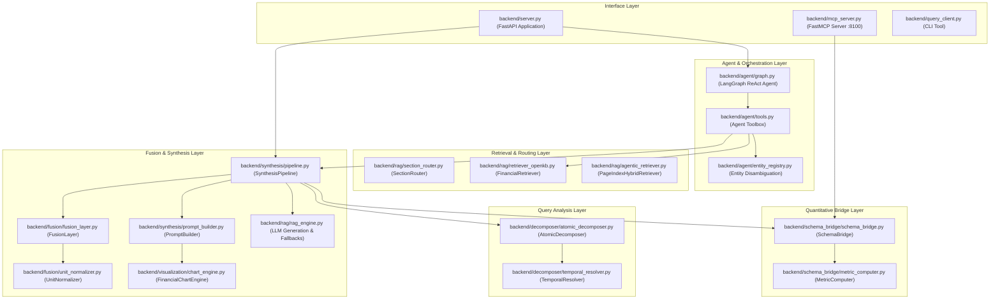
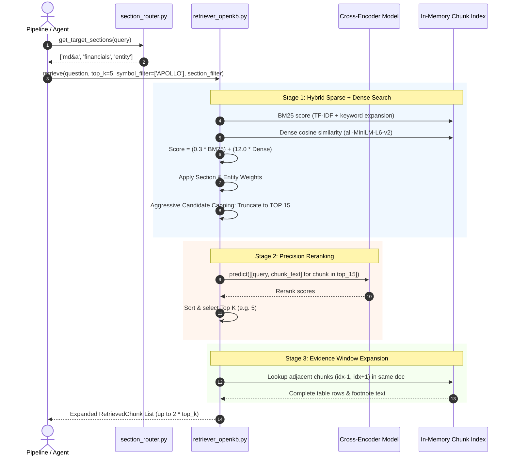

# Low-Level Design (LLD) — Financial RAG Platform 🛠️

## 1. Module Overview & Dependency Graph

Based on the static code analysis and AST extraction from `graphify-out` (1,836 nodes, 2,497 edges, 165 communities), the system is organized into modular packages with clean layer boundaries:



---

## 2. Component Details

### 2.1 Atomic Decomposer & Temporal Resolver
**Source Files:** [`backend/decomposer/atomic_decomposer.py`](file:///C:/Users/hp/Downloads/Financial-Rag/backend/decomposer/atomic_decomposer.py), [`backend/decomposer/temporal_resolver.py`](file:///C:/Users/hp/Downloads/Financial-Rag/backend/decomposer/temporal_resolver.py)

#### Responsibilities:
- Converts unstructured user queries into a list of typed `AtomicNeed` specifications.
- Normalizes Indian Fiscal Year notations (e.g., "FY24", "FY 2024-25", "last 3 years") into explicit integer years.
- Resolves metric keywords to underlying relational tables and columns.

#### Key Types & Enumerations:
```python
class NeedType(str, Enum):
    QUANTITATIVE    = "quantitative"      # Numbers backed by SQL
    QUALITATIVE     = "qualitative"       # Context from text/concalls
    FORWARD_LOOKING = "forward_looking"  # Guidance & future outlook
    COMPARATIVE     = "comparative"      # Multi-year or peer comparisons
    TECHNICAL       = "technical"        # RSI, MACD, Moving Averages
    MACRO           = "macro"            # Repo rate, CPI inflation
    OWNERSHIP       = "ownership"        # Shareholding, promoters

@dataclass
class AtomicNeed:
    need_type: NeedType
    metric: str
    symbol: str
    years: List[int]
    sub_type: str
    table: Optional[str] = None
    columns: List[str] = field(default_factory=list)
    time_horizon: TimeHorizon = TimeHorizon.HISTORICAL
```

#### Core Methods:
- `AtomicDecomposer.decompose(query: str, symbol: Optional[str]) -> List[AtomicNeed]`:
  Uses regex pattern libraries and keyword dictionaries to identify financial metrics, temporal spans, and required document types. For complex multi-intent questions, falls back to a low-temperature JSON LLM prompt.
- `resolve_year_range(raw_text: str, default_span: int = 3) -> List[int]`:
  Parses comparative temporal phrases (e.g., *"past 3 years"*, *"YoY since 2022"*) relative to the current fiscal anchor year.
- `SUBTYPE_TABLE_MAP`:
  Deterministic dictionary mapping 50+ financial sub-types to MySQL table representations:
  - `"revenue" -> ("profit_loss", ["sales"])`
  - `"ebitda" -> ("profit_loss", ["operating_profit", "depreciation"])`
  - `"net_profit" -> ("profit_loss", ["net_profit", "eps"])`
  - `"borrowings" -> ("balance_sheet", ["borrowings", "lt_borrowings", "st_borrowings"])`
  - `"cash_flow" -> ("cash_flow", ["cfo", "cfi", "cff", "capex", "free_cash_flow"])`

---

### 2.2 Schema Bridge & Metric Computer
**Source Files:** [`backend/schema_bridge/schema_bridge.py`](file:///C:/Users/hp/Downloads/Financial-Rag/backend/schema_bridge/schema_bridge.py), [`backend/schema_bridge/metric_computer.py`](file:///C:/Users/hp/Downloads/Financial-Rag/backend/schema_bridge/metric_computer.py)

#### Responsibilities:
- Translates `AtomicNeed` objects into REST API calls targeting the serverless AWS Lambda endpoint.
- Handles concurrent HTTP requests using a `ThreadPoolExecutor`.
- Filters JSON payloads by Indian Fiscal Year ranges (`April 1` through `March 31`).
- Deterministically computes mathematical derivatives (EBITDA, margins, YoY growth, CAGR).

#### Architecture:
```python
API_BASE = "https://zhwbvtkibdyhjy42gubo3qbsxq0pifuv.lambda-url.ap-south-1.on.aws"

_TABLE_TO_ENDPOINT = {
    "profit_loss":       {"path": "/api/v1/stocks/{symbol}/profit-loss", "date_key": "period_end"},
    "balance_sheet":     {"path": "/api/v1/stocks/{symbol}/balance-sheet", "date_key": "period_end"},
    "cash_flow":         {"path": "/api/v1/stocks/{symbol}/cash-flow", "date_key": "period_end"},
    "quarterly_results": {"path": "/api/v1/stocks/{symbol}/quarterly", "date_key": "period_end"},
    "price_daily":       {"path": "/api/v1/stocks/{symbol}/price", "date_key": "date"},
    "shareholding":      {"path": "/api/v1/stocks/{symbol}/shareholding", "date_key": "period_end"},
    "macro_indicators":  {"path": "/api/v1/macro/indicators", "date_key": "snapshot_date"},
}
```

#### Core Methods:
- `SchemaBridge.query_all(needs: List[AtomicNeed]) -> BridgeResult`:
  Dispatches concurrent requests for each unique `(table, symbol)` tuple, extracts relevant row objects, and filters by target fiscal years.
- `MetricComputer.compute_metrics(pl_rows, bs_rows, cf_rows) -> Dict[str, Any]`:
  - $\text{EBITDA} = \text{Operating Profit} + \text{Depreciation}$
  - $\text{EBITDA Margin} = \frac{\text{EBITDA}}{\text{Sales}} \times 100$
  - $\text{YoY Growth} = \frac{\text{Value}_t - \text{Value}_{t-1}}{\text{Value}_{t-1}} \times 100$
  - $\text{CAGR} = \left(\frac{\text{Value}_{\text{end}}}{\text{Value}_{\text{start}}}\right)^{\frac{1}{n}} - 1$

---

### 2.3 Structurally Selective Retriever (OpenKB)
**Source Files:** [`backend/rag/retriever_openkb.py`](file:///C:/Users/hp/Downloads/Financial-Rag/backend/rag/retriever_openkb.py), [`backend/rag/section_router.py`](file:///C:/Users/hp/Downloads/Financial-Rag/backend/rag/section_router.py)

#### Responsibilities:
- Indexes the hierarchical financial corpus (`backend/data/openkb_wiki/`):
  - `wiki/summaries/`: Chunked annual reports (e.g., Apollo Micro Systems FY25-FY26 Parts 1–11), investor transcripts.
  - `wiki/entities/`: Pre-compiled dossiers on subsidiaries, customers (DRDO, Indian Navy, BEL), banks, and directors.
  - `wiki/concepts/`: Financial & operational concepts (CWIP, Ind AS 103, Key Audit Matters, Gratuity, Contingent Liabilities).
- Implements two-stage retrieval with aggressive candidate capping and context expansion.

#### Multi-Stage Retrieval Pipeline:



#### Mathematical Scoring Formulation:
1. **Keyword Expansion:**
   Query keywords are expanded using financial domain synonyms:
   $$\text{Keywords}_{\text{expanded}} = \text{Keywords}_{\text{query}} \cup \bigcup_{k \in \text{Keywords}} \text{Synonyms}(k)$$
2. **Hybrid Candidate Score:**
   $$\text{Score}_{\text{base}} = 0.3 \cdot \text{BM25}(q, c) + 12.0 \cdot \max(0, \cos(\mathbf{e}_q, \mathbf{e}_c))$$
3. **Contextual Multipliers:**
   - Section Match: $\text{Score} \leftarrow \text{Score} \times 1.3$
   - Auditor Disclaimer Penalty: $\text{Score} \leftarrow \text{Score} \times 0.3$ (deprioritizes standard boilerplate)
   - Relational Query Boost: $\text{Score} \leftarrow \text{Score} \times 2.0$ for `entities/` and `concepts/`
4. **Candidate Capping:**
   Sort all chunks by $\text{Score}$ and aggressively prune the candidate pool to **exactly 15 candidates**. This eliminates 62% of Cross-Encoder computation compared to traditional 40-candidate pools.
5. **Cross-Encoder Score Fusion:**
   $$\text{Score}_{\text{final}} = \text{Score}_{\text{cross-encoder}} + 0.1 \cdot \text{Score}_{\text{hybrid}}$$

---

### 2.4 Fusion Layer & Unit Normalizer
**Source Files:** [`backend/fusion/fusion_layer.py`](file:///C:/Users/hp/Downloads/Financial-Rag/backend/fusion/fusion_layer.py), [`backend/fusion/unit_normalizer.py`](file:///C:/Users/hp/Downloads/Financial-Rag/backend/fusion/unit_normalizer.py)

#### Responsibilities:
- Integrates quantitative SQL records with qualitative management claims.
- Parses numeric statements from concall text using regex extraction.
- Detects discrepancies between management statements and audited financial statements.
- Enforces strict section diversity to prevent context starvation.

#### Core Data Structures:
```python
class InsightType(str, Enum):
    CONFIRM     = "CONFIRM"      # Claim aligns with audited SQL (+-10%)
    CONTRADICT  = "CONTRADICT"   # Claim diverges from audited SQL (>15%)
    FORWARD     = "FORWARD"      # Guidance / future projection
    UNMATCHED   = "UNMATCHED"    # SQL metric present without commentary

@dataclass
class FusionInsight:
    insight_type: InsightType
    symbol: str
    year: int
    metric: str
    sql_value: Optional[float]
    claim_value: Optional[float]
    explanation: str

@dataclass
class FusionResult:
    metric_table: List[Dict[str, Any]]
    concall_claims: List[ConcallClaim]
    insights: List[FusionInsight]
    annual_chunks: List[RetrievedChunk]
    concall_chunks: List[RetrievedChunk]
    errors: List[str]
```

#### Section Diversity Cap Algorithm (`_enforce_section_diversity`):
```python
_MAX_CHUNKS_PER_SECTION = 2

def _enforce_section_diversity(chunks: List[RetrievedChunk]) -> List[RetrievedChunk]:
    section_counts: Dict[str, int] = {}
    diverse_chunks: List[RetrievedChunk] = []
    
    for chunk in chunks:
        # Key combines symbol, year, and section identifier
        sec_key = f"{chunk.symbol}_{chunk.year}_{chunk.section}_{chunk.section_type}"
        current = section_counts.get(sec_key, 0)
        if current < _MAX_CHUNKS_PER_SECTION:
            diverse_chunks.append(chunk)
            section_counts[sec_key] = current + 1
            
    return diverse_chunks
```

---

### 2.5 LangGraph ReAct Agent & Fallback Interceptor
**Source Files:** [`backend/agent/graph.py`](file:///C:/Users/hp/Downloads/Financial-Rag/backend/agent/graph.py), [`backend/agent/tools.py`](file:///C:/Users/hp/Downloads/Financial-Rag/backend/agent/tools.py), [`backend/server.py`](file:///C:/Users/hp/Downloads/Financial-Rag/backend/server.py)

#### Responsibilities:
- Powers interactive user queries through an autonomous LangChain/LangGraph ReAct loop.
- Uses `ChatGroq(model="openai/gpt-oss-120b", temperature=0.0, max_retries=0)` to enable native tool calling.
- Intercepts 413 (payload too large) and 429 (TPM rate limit) exceptions without latency penalty, triggering instantaneous fallback to the deterministic legacy synthesis pipeline.

#### Toolbox Definition:
1. `get_live_price(symbols: List[str])`:
   Calls `yfinance` to fetch live quotes, day change percentages, and 52-week ranges.
2. `get_financial_data(symbols: List[str], metric_query: str)`:
   Triggers the `SynthesisPipeline` in quantitative-only mode to extract formatted tabular SQL data.
3. `search_company_documents(symbols: List[str], query: str)`:
   Invokes `FinancialRetriever` with section routing and token budget enforcement (capped at 24,000 characters).

---

### 2.6 Model Context Protocol (FastMCP) Server
**Source File:** [`backend/mcp_server.py`](file:///C:/Users/hp/Downloads/Financial-Rag/backend/mcp_server.py)

#### Architecture:
- Built with `mcp.server.fastmcp.FastMCP`.
- Serves 18+ equity research tools over `stdio` and `sse` transports.
- Maps MCP calls to the AWS Lambda backend via an asynchronous `httpx.AsyncClient` with connection pooling.

#### Tool Catalogue Breakdown:
| Category | Tool Name | Description |
| :--- | :--- | :--- |
| **Financials** | `get_profit_loss` | Annual, quarterly, and TTM Income Statements |
| | `get_profit_loss_items` | Granular line-item breakdown (raw materials, employee costs) |
| | `get_balance_sheet` | Assets, liabilities, equity, and net debt |
| | `get_balance_sheet_items`| Expandable line items for fixed assets, CWIP, borrowings |
| | `get_cash_flow` | CFO, CFI, CFF, Capex, and Free Cash Flow |
| | `get_quarterly_results` | Most recent quarterly announcements and margins |
| **Market** | `get_price` | Historical daily OHLCV series |
| | `get_technicals` | Moving averages, RSI, MACD, and Bollinger Bands |
| | `get_live_market_data` | Real-time ticker quotes via Yahoo Finance (`.NS` / `.BO`) |
| **Ownership** | `get_shareholding` | Promoter, FII, DII, and public holding patterns |
| | `get_corporate_actions`| Dividend history, stock splits, bonus issues |
| **Macro** | `get_rbi_rates` | Policy repo rates and monetary policy stances |
| | `get_macro_indicators` | GDP growth, CPI inflation, trade balances |
| **Documents** | `get_documents` | MinIO storage references to PDF filings and transcripts |
| **Ops & Health**| `get_health` | System liveness probe and component status |
| | `get_etl_logs` | Audit trail of data ingestion runs by symbol |

---

## 3. Data Contracts & Interfaces

### 3.1 RetrievedChunk Specification
```json
{
  "chunk_id": "APOLLO_AR_2026_P9_C14",
  "symbol": "APOLLO",
  "year": 2026,
  "doc_type": "annual_report",
  "section": "2026_Annual_Report_2026_part9",
  "section_type": "financials",
  "heading": "Consolidated Statement of Profit and Loss",
  "page_start": 4,
  "importance_score": 14.82,
  "text": "Revenue from operations for the year ended March 31, 2026 stood at Rs. 52,340.50 lakhs..."
}
```

### 3.2 FusionInsight Specification
```json
{
  "insight_type": "CONFIRM",
  "symbol": "APOLLO",
  "year": 2025,
  "metric": "sales",
  "sql_value": 37248.0,
  "claim_value": 37200.0,
  "explanation": "Management concall statement of approximately Rs 372 Cr matches audited revenue of Rs 37,248 Lakhs within 0.1% tolerance."
}
```
