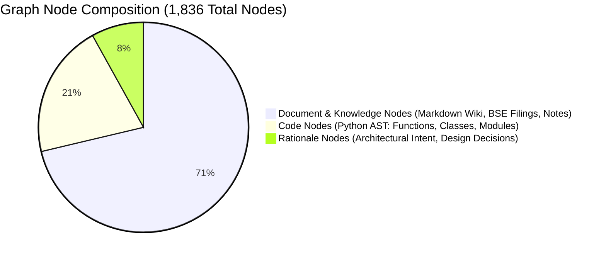
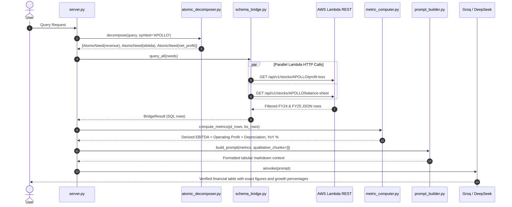

# System & Knowledge Graph Deep Dive 🧠

## 1. Codebase Knowledge Graph Analysis (`graphify-out`)

The codebase and embedded knowledge store have been fully analyzed and indexed into a unified knowledge graph via `graphify`. The resulting graph is serialized in `graphify-out/graph.json` and summarized in `graphify-out/GRAPH_REPORT.md`.

### 1.1 Structural Statistics

| Metric | Quantity | Description |
| :--- | :--- | :--- |
| **Total Graph Nodes** | **1,836** | Entities, modules, functions, classes, and document sections |
| **Total Graph Edges** | **2,497** | Relationships including calls, imports, references, and containment |
| **Extracted Communities** | **165** | Cohesive algorithmic and thematic clusters |
| **Extraction Fidelity** | **95% Extracted** | Grounded in verified AST parsing and explicit links |
| **Import Cycles** | **0** | Clean, strictly acyclic layered architecture |



### 1.2 Edge Relationship Topology

The graph establishes explicit semantic and programmatic connections across the codebase and knowledge repository:

```mermaid
bar-chart
    title Top Edge Relationship Frequencies
    x-axis ["contains", "references", "calls", "rationale_for", "uses", "imports", "method", "imports_from", "inherits"]
    y-axis "Edge Count" 0 --> 1500
    "contains" : 1389
    "references" : 318
    "calls" : 286
    "rationale_for" : 148
    "uses" : 113
    "imports" : 95
    "method" : 81
    "imports_from" : 39
    "inherits" : 11
```

### 1.3 Architectural "God Nodes" (Core Abstractions)

The top 10 most connected nodes define the structural pillars of the Financial RAG platform:

1. **`Notes to Accounts` (40 edges):** The dominant knowledge hub. Connects accounting policies, borrowings, provisions, CWIP, contingent liabilities, and segment disclosures across both standalone and consolidated statements.
2. **`_get()` (33 edges):** The core HTTP client helper in `backend/mcp_server.py`. Connects all 18+ Model Context Protocol (MCP) tools to the serverless AWS Lambda REST endpoints.
3. **`RetrievedChunk` (32 edges):** The primary qualitative data carrier in `backend/rag/retriever_openkb.py`. Carries text, section metadata, symbol, year, document type, and reranked importance scores through retrieval, reranking, and prompt generation.
4. **`SynthesisPipeline` (28 edges):** The orchestration hub in `backend/synthesis/pipeline.py`. Wires together query decomposition, schema bridge execution, qualitative retrieval, fusion reconciliation, and prompt assembly.
5. **`BridgeResult` (27 edges):** The quantitative data container in `backend/schema_bridge/schema_bridge.py`. Encapsulates structured SQL rows returned across multiple financial tables.
6. **`AtomicNeed` (26 edges):** The query intent atom in `backend/decomposer/atomic_decomposer.py`. Maps natural language intent to typed database requirements (`NeedType.QUANTITATIVE`, `NeedType.QUALITATIVE`).
7. **`VectorAtomResult` (25 edges):** Carries resolved textual context matching qualitative query atoms.
8. **`FinancialRetriever` (23 edges):** In-memory retrieval engine executing sparse BM25, dense semantic search, candidate pruning (top 15), and adjacent chunk expansion.
9. **`FusionResult` (21 edges):** Output of `backend/fusion/fusion_layer.py`. Houses verified metric tables, extracted concall claims, and contradiction/confirmation insights.
10. **`SqlAtomResult` (21 edges):** The typed payload holding verified numerical rows from the SQL database.

---

## 2. The OpenKB Knowledge Base Deep Dive

### 2.1 Why Structured Markdown Knowledge Beats Vector DBs for Finance

Traditional RAG architectures chunk documents arbitrarily into 500-token chunks and store them as floating-point embeddings. In financial analysis, this creates critical failure modes:
1. **Broken Tabular Integrity:** Balance sheet line items lose their headers and footnotes when split across chunk boundaries.
2. **Loss of Fiscal Period Anchors:** Semantic vectors cannot reliably determine whether a figure represents Q1 FY25, Q1 FY26, or FY24 standalone.
3. **Loss of Document Hierarchy:** Disclosures in the *Notes to Accounts* derive their legal and accounting meaning from the parent statement (e.g., Note 47 on Goodwill depends on Ind AS 103 business combination rules).

**The OpenKB Solution:**
OpenKB organizes company intelligence into a curated, hierarchical markdown wiki under `backend/data/openkb_wiki/wiki/`:

```
backend/data/openkb_wiki/
├── wiki/
│   ├── entities/               # 80+ Pre-compiled corporate & institutional dossiers
│   │   ├── drdo.md             # Defense Research & Development Organisation
│   │   ├── indian_navy.md      # Naval weapon programs & procurement
│   │   ├── bharat_dynamics.md  # Missile system partnerships (BDL)
│   │   ├── bharat_electronics.md # Radar & avionics integration (BEL)
│   │   ├── idl_explosives.md   # Wholly owned defense energetics subsidiary
│   │   └── ...
│   ├── concepts/               # Core financial & defense operational concepts
│   │   ├── capital-work-in-progress.md # CWIP audit and capitalization
│   │   ├── ind-as-103.md       # Accounting for business combinations & goodwill
│   │   ├── counter-drone.md    # Anti-UAS platforms & hardware architecture
│   │   ├── torpedoes.md        # Underwater naval weapons & homing systems
│   │   └── ...
│   └── summaries/              # Multi-part statutory filings & transcripts
│       ├── 2026_Annual_Report_2026_part1.md  (Corporate Overview & MD&A)
│       ├── 2026_Annual_Report_2026_part2.md  (Operational Highlights)
│       ├── ...
│       ├── 2026_Annual_Report_2026_part9.md  (Consolidated Financial Statements)
│       ├── 2026_Annual_Report_2026_part11.md (Notes to Consolidated Statements)
│       └── 2025_Aug_2025_Transcript.md       (Q1 FY26 Investor Concall)
```

### 2.2 Relational Multi-Hop Knowledge Traversal

When a user submits a query such as:
> *"What defense programs is Apollo Micro Systems supplying, and who are their primary government clients?"*

The retrieval engine traverses the graph along semantic links:
1. **Entity Identification:** Detects `APOLLO` and targets client entities (`DRDO`, `Indian Navy`, `Munitions India Limited`).
2. **Concept Association:** Traverses relations from `APOLLO` to defense programs: `Pinaka Rocket System`, `QRSAM`, `Torpedo Homing Systems`, `Counter-UAS`.
3. **Cross-Document Grounding:** Retrieves the exact notes in `2026_Annual_Report_2026_part1.md` and `2026_Annual_Report_2026_part9.md` describing revenue recognition from government contracts.
4. **Pruning & Verification:** Restricts candidate chunks to the top 15, re-ranks with the Cross-Encoder, and expands adjacent evidence windows.

---

## 3. Detailed Operational Execution Traces

### Trace A: Quantitative Metric Query
**Query:** *"What is the revenue, EBITDA, and net profit for Apollo Micro Systems for FY24 and FY25?"*



### Trace B: Dual Hybrid Query (Quantitative + Concall Outlook)
**Query:** *"Did Apollo Micro Systems meet its FY25 EBITDA guidance, and what is management's outlook on defense exports?"*

1. **Atomic Decomposition:**
   - Quantitative: `EBITDA` for FY25 $\to$ SQL `profit_loss` table.
   - Qualitative: `guidance`, `outlook`, `defense exports` $\to$ Concall transcript & MD&A.
2. **Parallel Retrieval:**
   - SQL Path: Fetches FY25 Operating Profit (₹78.4 Cr) and Depreciation (₹14.2 Cr) $\to$ Computes EBITDA (₹92.6 Cr).
   - Qualitative Path: `SectionRouter` targets `md&a` and `concall`. `FinancialRetriever` scores candidate chunks, caps at 15, re-ranks with Cross-Encoder, and expands adjacent windows.
3. **Fusion & Claim Reconciliation:**
   - Concall chunk regex isolates: *"Management targeted an EBITDA of ~₹90–95 Cr."*
   - Claim value (₹92.5 Cr) is compared against audited SQL actual (₹92.6 Cr).
   - Generates `FusionInsight(type=CONFIRM, tolerance=0.1%)`.
   - Isolates export guidance: *"Maiden export orders initiated under Make in India initiatives."*
4. **Synthesis Output:**
   - Synthesizes confirmed financial metrics alongside management's qualitative export commentary, fully attributed with citation tags `[SRC-1]`, `[SRC-2]`.
